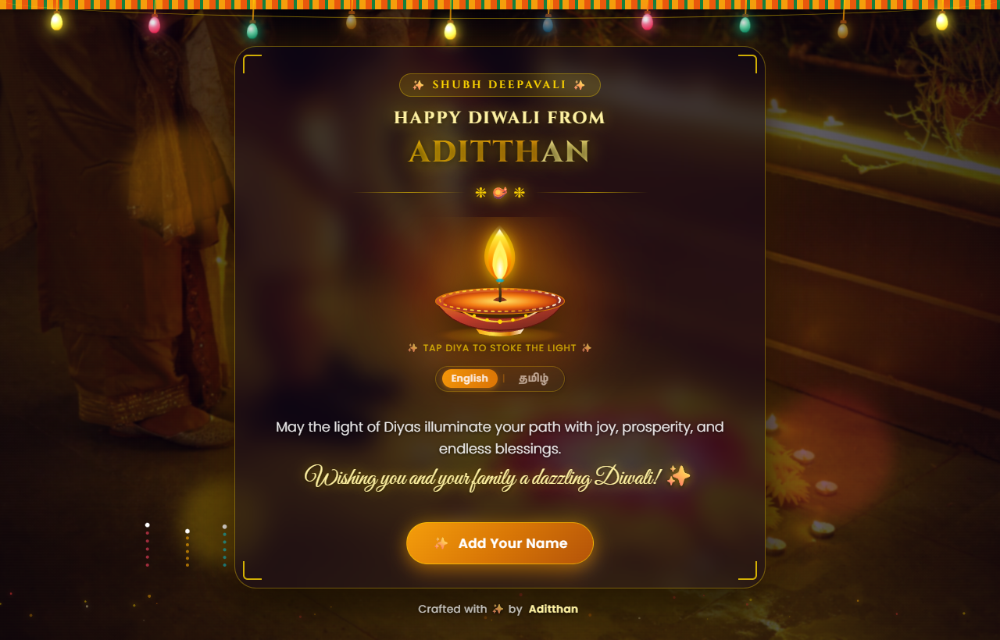
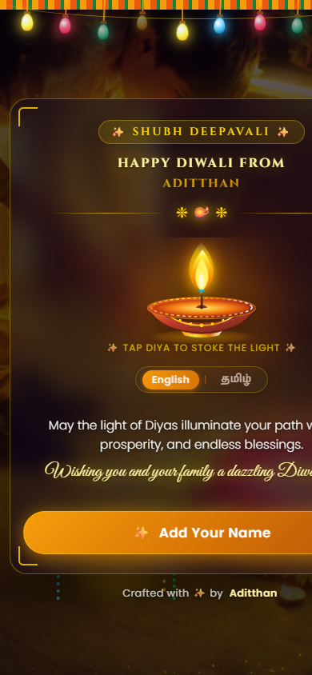

# 🪔 Festive-Zen — Interactive Diwali Celebration Experience

> An ambient, glassmorphic festive greeting experience featuring dynamic celebration visuals, interactive earthenware diya canvas, authentic bilingual typography, and one-click personalized link sharing.

---

## 📱 Live Previews

| 💻 Desktop Experience | 📱 Mobile Responsiveness |
| :---: | :---: |
|  |  |
| *Balanced framing with ambient festoon lighting* | *Optimized compact viewport with zero scroll* |

---

## ✨ Core Highlights

- **Cinematic Celebration Backdrop:** High-definition video loop flanked cleanly behind frosted glassmorphism.
- **Interactive Light & Canvas Diya:** Multi-layered animated flame with dynamic stoke reactivity and physics-based particle sparks.
- **Bilingual Crossfade Animation:** Automated 5-second alternating transitions between English and Tamil using Google Fonts (**Anek Tamil** and **Arima Madurai**).
- **Zero-Dependency Architecture:** Engineered purely with semantic HTML5, modern CSS3 (glassmorphic backdrop blur & CSS Grid stack), and vanilla JavaScript.
- **Personalized Sharing Engine:** Instant custom name generation with direct WhatsApp share formatting and clipboard copy triggers.

---

## 🚀 Quick Start

1. Clone the repository:
   ```bash
   git clone https://github.com/Aditthan-07/Festive-Zen.git
   cd Festive-Zen
   ```
2. Start any local HTTP server:
   ```bash
   python -m http.server 3000
   ```
3. Open in your browser:
   `http://localhost:3000`

---

## 👤 Author

Crafted with ✨ by **[Aditthan](https://github.com/Aditthan-07)**
